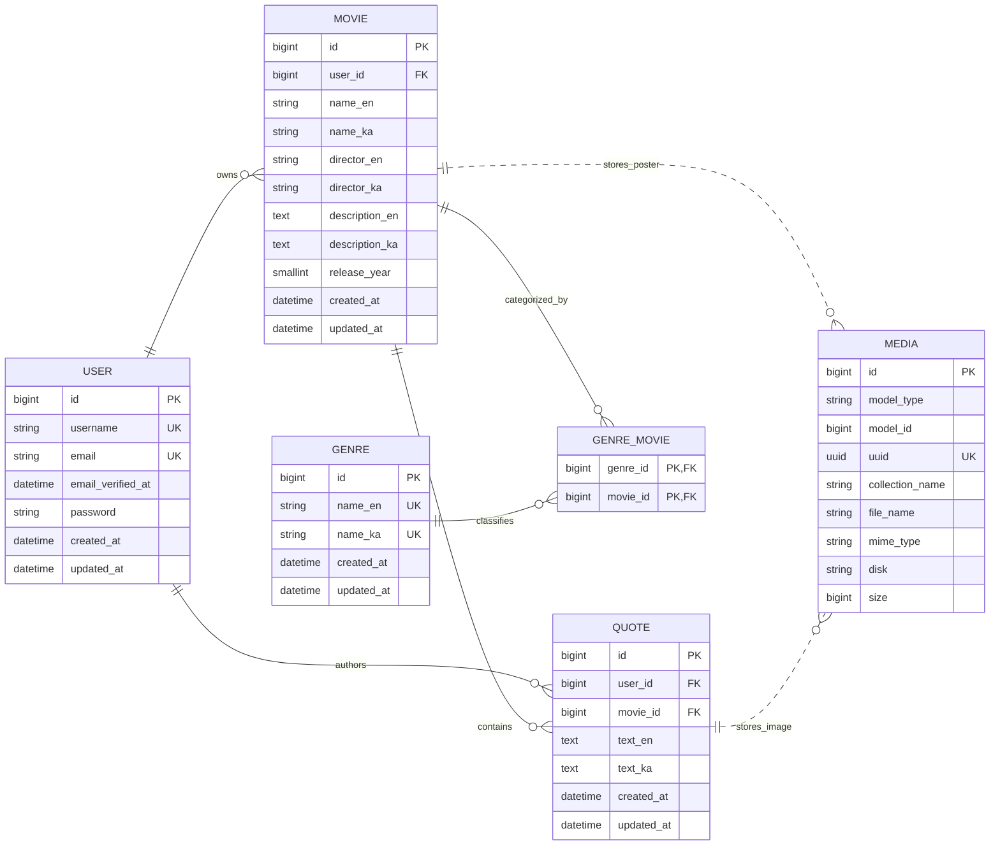

# Database schema

This diagram reflects the Movie Quotes tables implemented through PR 11. Migration files remain the executable source of truth.

`media.model_type` and `media.model_id` form Media Library's polymorphic association, so they are indexed but are not a database foreign key. A movie owns one item in the named `poster` collection and a quote owns one item in the named `image` collection. Their model lifecycles remove files and media rows on hard deletion.

Deleting a movie explicitly deletes its quote models before the database removes the movie, allowing Media Library to clean every quote image. Later social migrations must extend this diagram and preserve D-023 for quote comments, likes, and related notifications.
